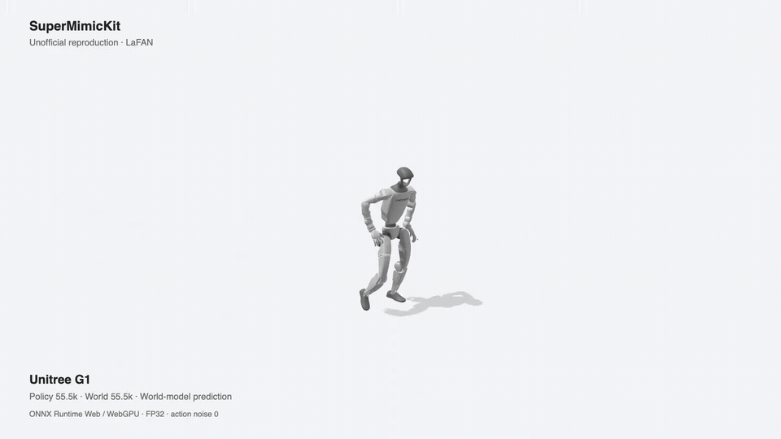

# SuperMimicKit

**面向 Unitree G1、Unitree H2 和 Agibot A3 的 SuperMimic 非官方复现。**

[English](README.md) · 简体中文

基于 PyTorch + MuJoCo Warp 训练，使用 UMR / SOMA Retargeter 重定向，通过 ONNX Runtime Web / WebGPU
运行浏览器 demo。独立实现，参考 [SuperMimic](https://supermimic.github.io/)
与 [supermimic_vibed](https://github.com/zita-ch/supermimic_vibed)。

[](docs/media/teaser.mp4)

[观看 36 秒 1080p 完整视频](docs/media/teaser.mp4)。实际浏览器录制：
G1 55.5k · H2 30k · A3 100k，ONNX Runtime Web / WebGPU。
World model 展示每 32 步与 MuJoCo 物理状态重新同步。

## 项目进展

- [x] G1 / H2 / A3 配置与 Git LFS 管理的统一机器人资产。
- [x] LaFAN 重定向，以及明确的 train40 / 独立 val37 划分。
- [x] FP32 训练，可选 TF32 / BF16，支持编译与 CUDA graphs。
- [x] 各机器人独立记录 SwanLab 训练指标与完整动作评测。
- [x] Policy / world model ONNX 导出与 WebGPU demo 集成；MuJoCo 物理使用 WASM。
- [x] 每 10k iterations 保存配套 policy + world model 权重，包含归一化状态。
- [x] 发布 LaFAN ONNX 预览：G1 55.5k policy / 55.5k world、H2 30k、A3 100k。
- [x] 公布 G1/H2 train40 / val37 指标。
- [ ] 核验并公布 A3 精确 100k 完整动作评测。
- [ ] **BONES-SEED checkpoint**：SOMA Retargeter 集成、训练与发布。
- [ ] **GRAIL checkpoint**：动作与场景验证、包含场景的训练与发布。

## 性能报告

以下为开发阶段实测，不代表已达到论文的收敛效果。

| 项目 | 结果 | 条件 |
| --- | --- | --- |
| G1 训练吞吐 | **2.18 iterations/s** · 0.459 s/iteration | H100，4,096 envs，TF32，compile + CUDA graphs |
| GPU 利用率 | **84.7%** | 同一短跑测试，33 次 GPU 采样 |

吞吐为 36 个测量 iteration 的均值，不含初始编译时间；不等于训练全程耗时或浏览器速度。
历史 50k ONNX 数值验证单独记录在[测量说明](docs/performance.md)，
不代表下方预览 checkpoint 的验证结果。

## 预训练模型预览

[下载预览版](https://github.com/OMEGA-i/SuperMimicKit/releases/tag/demo-preview-20261024)
· [选型、评测与限制](docs/preview-release.md)

| 机器人 | Policy / world iterations | train40 回报 · 失败 | val37 回报 · 失败 |
| --- | --- | --- | --- |
| G1 | **55.5k / 55.5k** | 0.7990 · 3/40 | 0.3103 · 31/37 |
| H2 | **30k / 30k** | 0.6526 · 6/40 | 0.2600 · 30/37 |
| A3 | **100k / 100k** | 待补 | 待补 |

G1/H2 使用较早 checkpoint，是因为后期完整动作评测退化：G1 100k 在 train40
失败 40/40，H2 45k 失败 37/40。根因仍在调查，不能归因于 ONNX 转换。
H2 使用修正骨盆惯量后重新训练的版本；G1 policy 和 world 均使用同次导出的 55.5k。

回报为各动作 `sum(reward)/(0.1*(frames-1))` 的等权平均，提前终止后计零回报；
不是训练单步回报，也不代表 world model 精度。train40 名单尚未与论文作者确认一致。

模型包包含 FP32 ONNX、元数据及机器人资产。由于源数据再分发限制，**不包含动作文件**，
运行网页前需要自行准备有相应许可的兼容动作。这是实验预览，不是可直接部署的控制器。

## 快速开始

```bash
git lfs install
git clone --recurse-submodules https://github.com/OMEGA-i/SuperMimicKit.git
cd SuperMimicKit
git lfs pull
git -C third_party/soma-retargeter lfs pull
uv venv --python 3.12 .venv
uv pip install --python .venv/bin/python -e '.[mjwarp,qc,test,tracking,web-refresh]'
```

G1、H2、A3 机器人资产已包含在 `assets/robots`，mesh 使用 Git LFS。
训练前需准备具有相应使用许可的重定向动作。
原版 [SOMA Retargeter](https://github.com/NVIDIA/soma-retargeter) 以固定版本子模块存放在
`third_party/soma-retargeter`。按需为各重定向工具安装独立环境，方法见下方指南。
参考[安装、数据与训练指南](docs/getting_started.md)、
[UMR 集成说明](third_party/umr_overlay/README.md)和[浏览器 demo 指南](web/demo/README.md)。

## 数据集计划

后续版本以已验证的跟踪质量为依据，不默认轮次越高越好。

| 数据集 | 处理流程 | 发布计划 |
| --- | --- | --- |
| LaFAN | 原始数据 → SMPL-X → UMR → 50 Hz motions | G1 55.5k/55.5k、H2 30k、A3 100k 预览 |
| BONES-SEED | 120 Hz SOMA BVH → 50 Hz 重采样 → SOMA Retargeter → 训练格式动作 | G1 / H2 / A3 checkpoint，时间待定 |
| GRAIL | 原始数据 → SMPL-X + scenes → UMR → 配套 motions 与 scenes | G1 / H2 / A3 checkpoint，时间待定 |

BONES-SEED 流程不额外落盘一份完整 SOMA 数据。公开仓库已包含上游子模块，
端到端训练格式适配器尚未包含。GRAIL 场景始终与重定向动作配套。
数据集和模型的再分发遵循各自许可。

## 致谢

感谢 [SuperMimic 作者](https://supermimic.github.io/)、
[supermimic_vibed](https://github.com/zita-ch/supermimic_vibed)、
[UMR](https://github.com/hanyang9/UMR)、
[SOMA Retargeter](https://github.com/NVIDIA/soma-retargeter) 及机器人与数据集贡献者。
本项目使用的 UMR fork 为 [OMEGA-i/UMR](https://github.com/OMEGA-i/UMR)。
第三方代码、模型和数据集保留各自许可证及声明。
